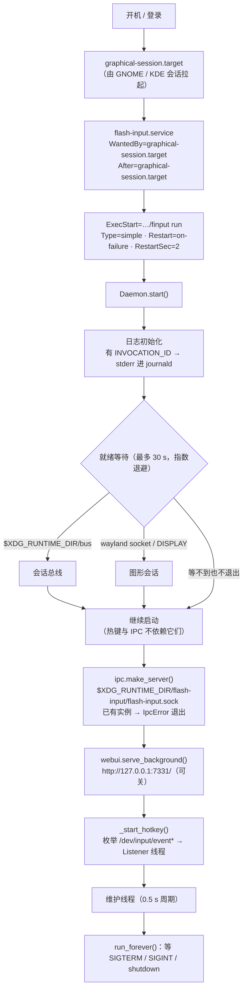
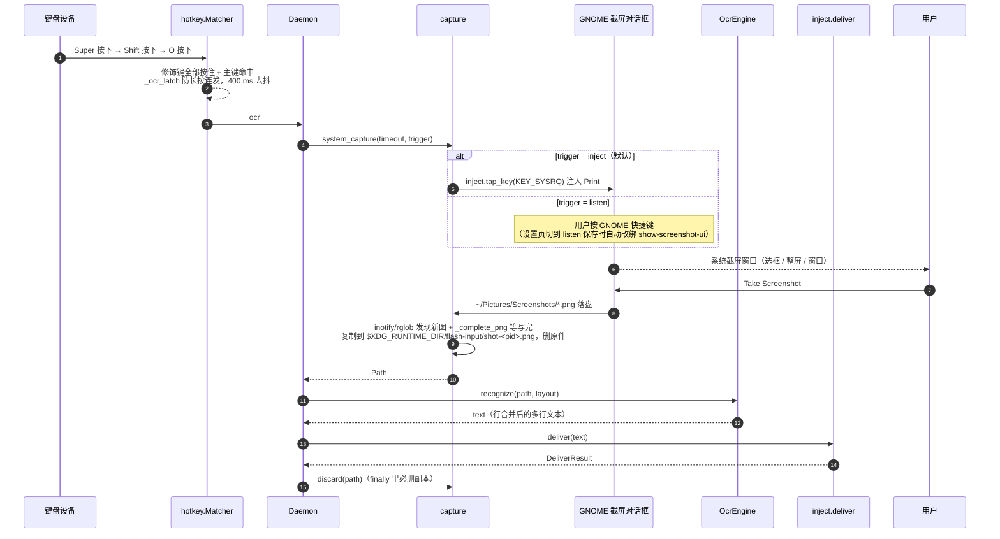
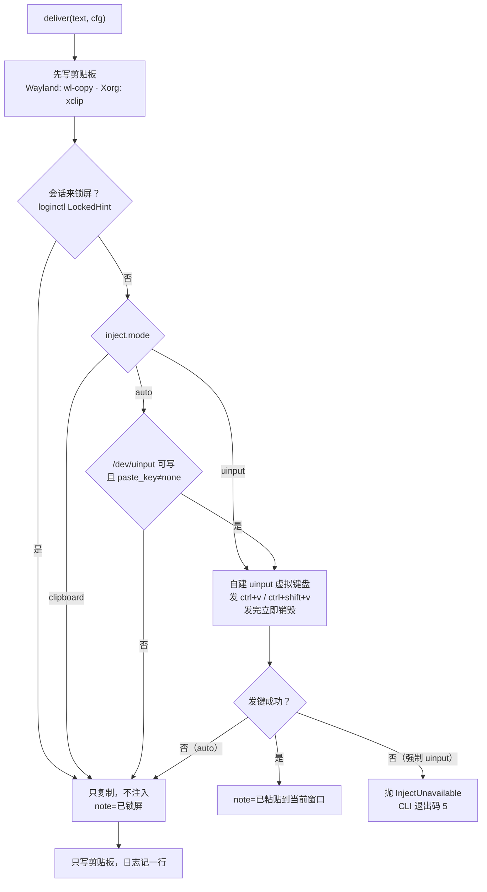
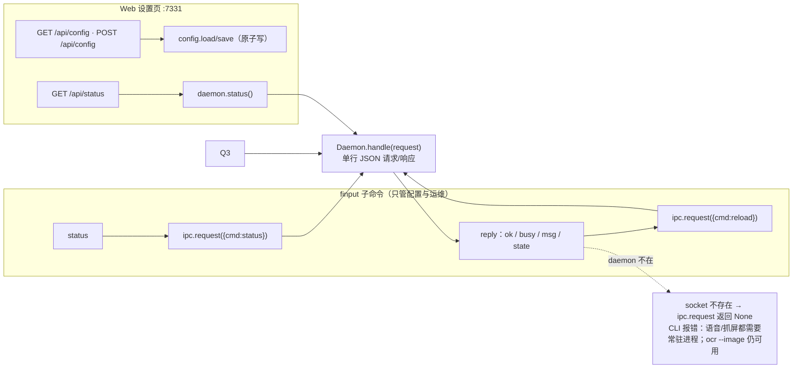
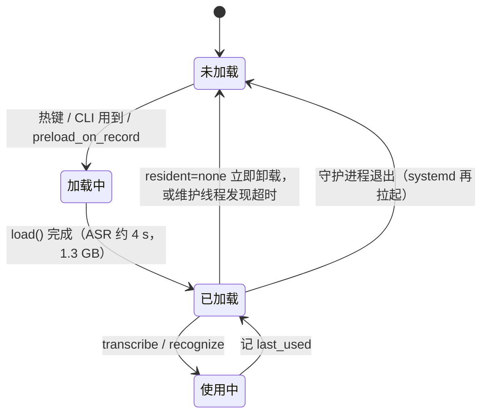
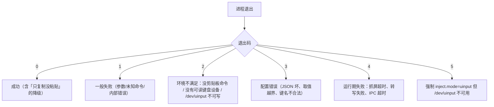

# Flash Input 运行流程

守护进程 `finput run` 是唯一常驻的进程，所有入口（热键、命令行、设置页）最终都汇到它的
`handle()` 上。本文按「谁在什么时候做什么」画成图，尺寸、时序都对应
`src/flash_input/service.py` / `daemon.py` / `hotkey.py` / `inject.py` 里的实现。

## 1. 开机：systemd 拉起守护进程

关键点：

- unit 里的 `After=` 只是「优选」：真正保证可用的是 `start()` 里的**有界就绪等待**，
  所以合成器没正确拉起 target 时也不会死循环重启。
- socket 在建好之后才接热键，客户端看到「socket 存在」就等于「能收命令」。
- `Restart=on-failure` + `StartLimitBurst=5`：崩了 2 s 回来，反复崩 5 次后停下，不会刷屏。

## 2. 语音：按住说话

抓屏没有第二条通道：没有 `xdg-desktop-portal`、没有 `grim`/`maim`/`import`。窗口打不开就等到
`ocr.timeout_s`（默认 60 s）超时，随后这次抓屏失败、单飞锁释放。

## 4. 文字落地：剪贴板 + uinput 粘贴

要点：

- 中文**永远走剪贴板**：uinput 只发粘贴组合键，不逐字打码点（否则要过 IME，必坏）。
- 每次粘贴临时 `UI_DEV_CREATE` → 发键 → `UI_DEV_DESTROY`，不长期占一个虚拟键盘。
- `EV_SYN` 不能显式 `UI_SET_EVBIT`（内核返 `EINVAL`），这是踩过的坑。

## 5. 命令行 / 设置页入口

`ocr --image` 这条带显式输入的路径**不需要 daemon**（只加载模型），直接在 CLI 进程里跑完
（用的还是同一套 ocr/inject 代码）。语音与抓屏没有 CLI 入口：它们由热键直接驱动 daemon，
daemon 不在就没有监听者。

## 6. 常驻与内存回收

| 模型 | `resident` 取值 | 行为 |
|---|---|---|
| ASR | `none` / `10min` / `30min` / `forever` | 默认 `10min`；超时后 `unload()`，RSS 回落到 ~1.3 GB |
| OCR | 同上 | 默认 `30min`；加载后约 170 MB |

维护线程每 0.5 s 跑一次，`busy` 时不卸载，避免把正在推理的模型抽走。

## 7. 异常与退出码

守护进程侧：`Restart=on-failure` 只处理**非 0 退出**；正常 `systemctl --user stop`
是 `SIGTERM`，`run_forever()` 收到后走 `shutdown()`，退出码 0，不会触发重启。

## 相关文件

| 文件 | 内容 |
|---|---|
| `src/flash_input/service.py` | unit 模板、`install/uninstall/status/logs` |
| `src/flash_input/daemon.py` | 就绪等待、IPC、单飞、常驻维护 |
| `src/flash_input/hotkey.py` | evdev 读取、组合匹配、守卫 |
| `src/flash_input/inject.py` | uinput 粘贴与降级 |
| `src/flash_input/ipc.py` | unix socket 单行 JSON 协议 |
